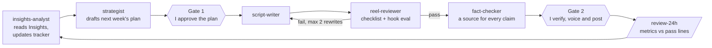

# aipm.decoded studio

**An agentic content studio, built in Claude Code, for a live product: my
Instagram page [@aipm.decoded](https://www.instagram.com/aipm.decoded/).**

Five specialist agents analyse, plan, script, review and fact-check. Every
rule they follow lives in files. I approve the work at two gates, and I'm the
only one who posts.

Built by [Sohini Chakraborty](https://www.linkedin.com/in/sohini01), product manager.

---

## Why I built it

I run a 5-reels-a-week page for people breaking into product management. After
30 days, the data told a clear story:

| | |
|---|---|
| Posts | 23 (17 reels judged, 5 carousels) |
| Reel views | 5,615, **94% from people who don't follow the page** |
| Profile visits and follows credited to any post | **0** |

The page could reach strangers but couldn't convert them. The fix was already
written in my own playbook (say who it's for, add a first-person line), but it
hadn't made it into a single posted reel. **Rules that live in my head don't get
applied every time. Rules in files, checked by a reviewer, do.** So I turned the
workflow into a product. See the [PRD](docs/PRD.md).

## How it works



| Command | What happens |
|---|---|
| `/weekly-loop` | Analyst updates the tracker, strategist drafts the plan, then **stops for Gate 1** |
| `/new-reel <item>` | Script, review (rewrite up to 2x), fact-check, then **stops for Gate 2** |
| `/review-24h <reel>` | Logs the reel's metrics, applies the decision rules, adds a learning |
| `/eval-hooks` | Tests whether the reviewer can tell winning hooks from losers, blind |

## Product decisions in the build

| Decision | Why |
|---|---|
| **Two human gates, written as STOP steps** | I keep the calls that matter: what we make, and what goes live |
| **Judges can't edit** | The reviewer and fact-checker have no edit access to scripts, so they can't quietly fix what they're meant to judge |
| **Numbers only from data** | Agents quote metrics from `tracker.csv` via `scorecard.py`. Missing data is written `MISSING`, never estimated |
| **Guardrail as code** | A `PreToolUse` hook blocks any agent write to `posted/`. Only I mark something as published |
| **Blind evals** | The reviewer predicts hook results without seeing outcomes. `settings.json` denies it read access to the answer key |
| **No posting tools at all** | Non-goal by design: no auto-posting, replies or DMs |
| **Decisions logged with evidence** | Every change has a reason and a metric in [`docs/decisions-log.md`](docs/decisions-log.md) |

## Run it

Needs [Claude Code](https://docs.claude.com/en/docs/claude-code/overview) and Python 3.
The analyst reads Instagram Insights through Claude in Chrome, so connect it to
Claude Code (or paste the numbers into `data/tracker.csv` yourself).

```bash
cd aipm-studio
python3 scripts/scorecard.py --followers 19   # numbers straight from the tracker
claude                                        # then: /weekly-loop
```

## What's inside

```
CLAUDE.md                 rules every agent follows
playbook/                 instagram-playbook, hook-formulas, pass-lines,
                          brand-end-card, reel-learnings, idea-bank
.claude/agents/           insights-analyst, strategist, script-writer,
                          reel-reviewer, fact-checker
.claude/commands/         weekly-loop, new-reel, review-24h, eval-hooks
.claude/skills/           aipm-reel-follow-checklist, aipm-concept-walkthrough-reel
.claude/settings.json     permissions + the posted/ guard hook
data/                     tracker.csv (23 real posts), weekly-plan.md
evals/                    17 real hooks with outcomes, results log
scripts/                  scorecard.py, score_eval.py, guard_posted.py
docs/                     PRD, architecture, decisions log
drafts/  posted/          work in progress, and what's live
```

## Status

- **v1 built 23 Nov 2026.** Seeded with 30 days of real data and 7 logged decisions.
- **First live run:** week of 23 Nov. Experiment: does a who-it's-for line at
  10-12s move profile visits? (pass line: 3 per reel)
- **Goal:** 2 follows per 100 weekly viewers, 40+ followers by 6 Dec 2026.

Results and eval scores will be added here as they come in.
