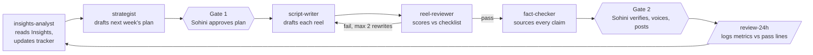

# Architecture

## The weekly loop

## Agents

| Agent | Reads | Writes | Never does |
|---|---|---|---|
| `insights-analyst` | Instagram Insights (via Claude in Chrome), `tracker.csv` | `tracker.csv`, weekly analysis | Draft content or recommend stopping a pillar |
| `strategist` | Tracker, playbook, idea bank, learnings | `data/weekly-plan.md` (draft) | Approve its own plan |
| `script-writer` | Approved plan, playbook, hook formulas | `drafts/<date-slug>/script.md` | Write Sohini's first-person line |
| `reel-reviewer` | Script, follow-checklist skill, playbook | `drafts/<date-slug>/review.md` | Edit the script |
| `fact-checker` | Script, the web | `drafts/<date-slug>/sources.md` | Soften a claim without saying so |

Each agent gets only the tools it needs (see the `tools:` line in each agent file).
The reviewer and fact-checker can't edit scripts, so they can't quietly fix what
they're meant to judge.

## Data contracts

**`data/tracker.csv`**: one row per post.
`date, date_approx, title, format, pillar, views, non_follower_pct, likes, saves,
shares, profile_visits, follows, skip_rate_pct, avg_watch_pct, notes`
Empty cell = not collected. Agents write `MISSING` in reports, never a guess.

**`drafts/<yyyy-mm-dd>-<slug>/`**: one folder per reel.
- `script.md`: hook, beat-by-beat script, on-screen text, caption, CTA
- `review.md`: checklist score, pass/fail per item, required fixes
- `sources.md`: each claim, its source URL, and VERIFIED / UNVERIFIED

## Guardrails
- `.claude/settings.json` runs `scripts/guard_posted.py` before every Write or Edit.
  Any write into `posted/` is blocked, so only Sohini can mark something published.
- No agent has a posting tool. The browser is used only for reading Insights.
- Gates are written into each command as explicit STOP steps.

## Evals
`evals/hook-eval-set.csv` holds the 17 reels from the first 30 days: the first-frame
text and the real result (won ≥ 500 views, average 200-499, lost < 200).
`/eval-hooks` asks the reviewer to predict each label from the hook alone, blind to
the outcome. `scripts/score_eval.py` scores agreement. If the reviewer can't tell
winners from losers, the checklist needs to change, not just the scripts.
